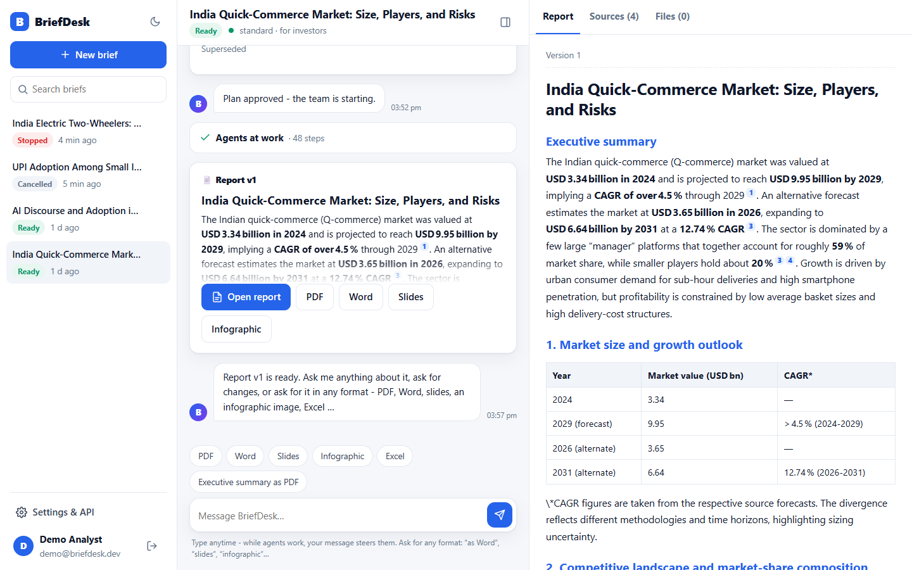
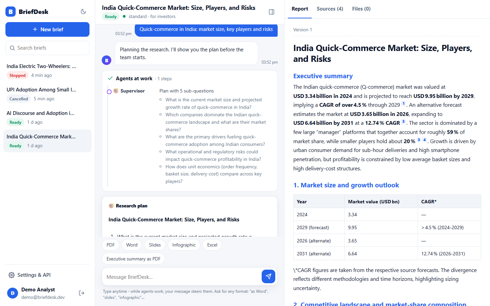
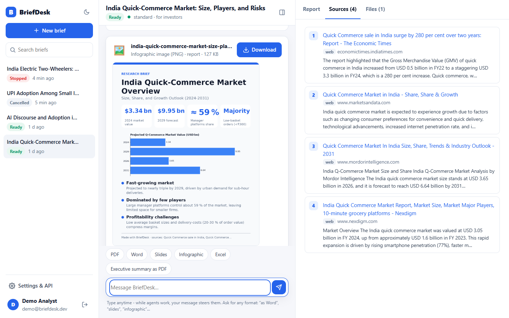

# BriefDesk: multi-agent research briefs you can trust

[](https://github.com/mani2810/briefdesk/actions/workflows/ci.yml)


You give BriefDesk a topic. A **team of AI agents** handles the brief:

- The **Supervisor** plans it, and **you approve the plan**.
- The **Researcher** reads the web and your own documents (through MCP).
- The **Writer** drafts a cited brief.
- The **Reviewer** critiques it.
- The **Verifier** checks **every citation against the text of the page it came from**.

You chat with the agents **live** the whole time. While they work you can steer them, ask questions or request a revision. When the brief is ready, ask for it in any format, for example "as Word", "slides for my manager" or "a dark infographic".



| Live agent trace | Ask for any format (here: an AI-designed infographic) |
|---|---|
|  |  |

## Why

Writing a researched brief by hand takes hours of searching, reading, writing and reviewing. Plain chatbots are fast, but their answers have no sources, or sources they made up, so nobody can sign off on them.

BriefDesk's promise is **fast *and* checkable**:
- The plan is human-approved.
- Every claim carries a numbered source.
- Each citation is verified against the page it came from.
- Everything the agents did is visible.

## What it does

| | |
|---|---|
| 🧭 **Plan approval** | The Supervisor drafts 3–6 sub-questions. You edit, add or remove questions, then approve. LangGraph `interrupt()` pauses the graph, and the SQLite checkpointer keeps the pause across restarts. |
| 🔎 **ReAct researcher** | Searches with DuckDuckGo and reads pages with a safe fetcher. It calls **any MCP tool** you configure. Every page it reads becomes a numbered source `[n]`. |
| ✍️ **Streaming writer** | The report streams token by token into the chat over a WebSocket. |
| 🧐 **Reviewer loop** | Its verdict is approve, research more, or rewrite. The Supervisor routes the work, and loops are bounded. |
| ✅ **Citation verifier** | Every cited sentence is checked against its source. Lexical evidence matching comes first, with a strict rule that figures must appear in the source. One cheap LLM check follows for paraphrases. Unsupported claims go back to the Writer. |
| 💬 **Two-way live chat** | Type anytime. While agents work, your message becomes guidance the Supervisor picks up at its next step. Afterwards, you can ask questions (answered from the sources) or request revisions (v2, v3, …). |
| 📦 **Any output format** | PDF · Word · PowerPoint · PNG/JPG infographic · Excel · CSV · Markdown · HTML · JSON · TXT, from plain English. The Publisher agent reshapes the content per format. For example, slides get one idea per slide with speaker notes, and spreadsheets get tables extracted from the report. Impossible requests ("a video") get the closest format plus an honest note. |
| 🔌 **MCP both ways** | **Client:** plug MCP servers into the researcher from `mcp_servers.json`, with no code change. **Server:** Claude Desktop, Claude Code or any MCP client can create, question, revise and export briefs. |
| 🛡️ **Admin** | Users, LLM usage per agent, circuit-breaker state, MCP server health, failed runs. |

## Architecture

```
 HTML/CSS/JS SPA ──REST + WebSocket──►  FastAPI (one process)
                                         ├─ auth: short-lived JWT in memory + rotating refresh token in an httpOnly cookie
                                         ├─ chat hub: events persisted first, then fanned out; replay after reconnect
 Claude Desktop / Code ──MCP (stdio)──►  ├─ mcp_server/ (thin client over the same REST API, personal API token)
                                         └─ job runner: agent pool + task pool (threads)
                                                 │
                       LangGraph StateGraph + SQLite checkpointer (pause · steer · resume · retry · revise)
   Supervisor ─► Researcher (ReAct: web_search, read_page, MCP tools) ─► Writer ─► Reviewer ─► Verifier ─► finalize
        ▲________________________ every worker returns to the Supervisor _________________________│
                                                 │
   LLM gateway (Groq): run budget · cache · circuit breaker per model · token pacer per model · bounded retry
   Conversation agent (intent router) · Publisher agent (format → shape → render)
                                                 │
   SQLAlchemy + Alembic: users · briefs · runs · events · sources · report_versions · citations · files · api_tokens
```

More detail is in [docs/ARCHITECTURE.md](docs/ARCHITECTURE.md).

**Stack:** Python · FastAPI · WebSockets · LangGraph · LangChain · Groq (gpt-oss-120b, gpt-oss-20b, qwen) · MCP (Python SDK 2) · SQLAlchemy · Alembic · reportlab · python-docx · python-pptx · openpyxl · matplotlib · vanilla HTML/CSS/JS (no build step, no CDN)

## Run it locally (Windows / macOS / Linux)

Requires **Python 3.11+**.

```bash
git clone https://github.com/mani2810/briefdesk.git
cd briefdesk
python -m venv .venv
.venv\Scripts\activate            # macOS/Linux: source .venv/bin/activate
pip install -r requirements.txt
```

**Option A – offline demo (no API key, no internet):** the AI and the web pages are scripted, so the whole UI works end to end.

```bash
python run.py --demo
```

**Option B – the real thing (free Groq key):**

```bash
copy backend\.env.example backend\.env      # macOS/Linux: cp backend/.env.example backend/.env
# edit backend/.env and set GROQ_API_KEY=...   (free key: https://console.groq.com/keys)
copy mcp_servers.example.json mcp_servers.json   # optional: the example MCP knowledge base
python run.py
```

Open **http://localhost:8000** and log in with **demo@briefdesk.dev / Research2026**. The admin account is `admin@briefdesk.dev` / `ChangeMe!2026`; change that password in Settings.

### About the Groq free tier

Groq's free tier allows about **8,000 tokens per minute per model**. BriefDesk is built for that limit:
- **Agents are spread across three models.** Routing, chat and notes use qwen; the researcher uses gpt-oss-20b; the writer and reviewer use gpt-oss-120b. Each model has its own token allowance.
- **The gateway paces itself.** When it nears a limit it waits and shows "Pacing for the Groq free-tier token limit…" in the chat, instead of failing with 429 errors.
- **The supervisor only calls the LLM at real decision points.** It uses a deterministic state machine otherwise.
- **The researcher keeps its history compact.** Older tool results are summarised before each call.

A standard brief takes roughly **2–5 minutes** on the free tier. If a model is still exhausted, the run degrades gracefully instead of failing: deterministic routing, research without the model, and the final draft is always verified. Progress is checkpointed, so "retry" continues from the last completed step.

## Use BriefDesk from Claude (MCP server)

1. In BriefDesk, open **Settings & API** and create a token. The dialog shows a ready-made config.
2. In Claude Desktop, open Settings → Developer → Edit config and add:

```json
{
  "mcpServers": {
    "briefdesk": {
      "command": "C:\\path\\to\\briefdesk\\.venv\\Scripts\\python.exe",
      "args": ["C:\\path\\to\\briefdesk\\mcp_server\\briefdesk_mcp.py"],
      "env": { "BRIEFDESK_URL": "http://127.0.0.1:8000", "BRIEFDESK_TOKEN": "bd_..." }
    }
  }
}
```

The server provides five tools: `create_brief`, `get_brief`, `list_briefs`, `ask` (question, revise or steer) and `export_brief`. Exports are saved to `~/Downloads/BriefDesk`. The MCP server goes through the same REST API, so quotas, rate limits and ownership rules apply. An API token cannot change passwords, manage tokens or reach admin endpoints.

## Plug your own tools into the researcher (MCP client)

`mcp_servers.json` uses the same shape as Claude Desktop's config, plus an allow-list:

```json
{ "servers": { "company_kb": {
    "command": "python", "args": ["examples/company_kb_mcp/server.py"],
    "allowed_tools": ["search_company_docs"], "description": "Internal market notes" } } }
```

Here is how it behaves:
- **New tools appear automatically.** The researcher sees `company_kb__search_company_docs` next to web search; MCP results become citable sources and show an MCP badge.
- **A broken server is isolated.** If a server fails to start, it is logged and skipped.
- **Tool output is untrusted data.** The prompts treat it like web content and never follow instructions inside it.

## Production-minded details

- **Security:**
  - The refresh token is an httpOnly, SameSite=Strict, path-scoped cookie with rotation and reuse detection. The access token is kept in memory only.
  - Refresh and logout require a custom header, there are no CORS grants, and a strict CSP is set (`script-src 'self'`, no inline scripts).
  - WebSockets use 60-second single-use tickets plus an Origin check.
  - Logins are protected by per-(email, IP) lockout, bcrypt and a constant-time compare.
  - The page fetcher has an **SSRF guard**: public IPs only, re-checked on every redirect, with size and time caps.
  - Spreadsheet exports are protected against **formula injection**.
  - The Markdown renderer is safe by construction: everything is escaped and only allow-listed tags are emitted.
  - Users are isolated (a 404 for anything that isn't theirs) and secrets are redacted from logs.
- **Reliability:**
  - Agent runs never block HTTP requests or sockets.
  - LangGraph checkpoints make pause, resume and retry survive restarts.
  - On startup, the server recovers interrupted runs.
  - Every loop is bounded: a per-run LLM-call budget, an iteration guard and a research-round limit.
  - Each model has its own circuit breaker.
- **Observability:** per-request ids, JSON logs, an audit log, admin dashboards showing tokens and calls per agent, pacing waits and failed runs.
- **Quality:**
  - The tests run fully offline (scripted LLM plus sample pages). They cover the whole flow: plan → approval → agents → verified report → chat, exports, revision, steering, cancel/retry and user isolation.
  - CI runs on Python 3.11 and 3.13.

```bash
cd backend && pytest -q
```

## Project layout

```
backend/app/
  agents/      graph.py (Supervisor + workers), verifier.py, publisher.py, prompts.py, schemas.py
  llm/         gateway.py (guards, pacing), fake.py (offline brain)
  tools/       web.py (search, safe fetch), registry.py, mcp_client.py
  renderers/   pdf, docx, pptx, image, xlsx/csv, html, md, json, txt
  services/    runner.py (jobs + checkpoints), chat.py (conversation agent), hub.py (live fan-out), briefs.py
  api/         REST routes + WebSocket
frontend/      index.html, css/app.css, js/ (app, chat, report, admin, settings, markdown, socket, api)
mcp_server/    briefdesk_mcp.py   - BriefDesk as an MCP server
examples/      company_kb_mcp/    - example MCP server for the researcher
```

## License

Free for learning, research and personal use under the [PolyForm Noncommercial License 1.0.0](LICENSE.md).
**Commercial use requires permission.** [Open a commercial-licence request](https://github.com/mani2810/briefdesk/issues/new?template=commercial-licence.md).
